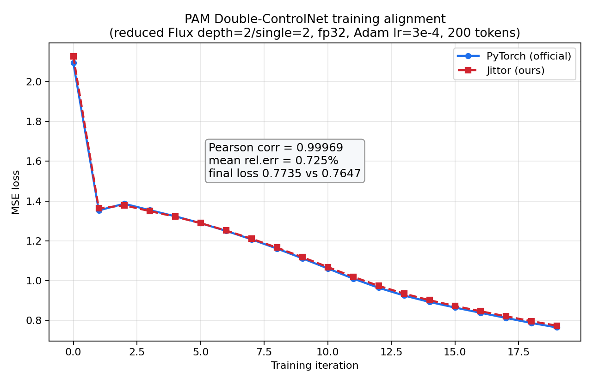

# PAM-Jittor：用 Jittor 复现 PAM 第一阶段（Flux-dev + Double ControlNet 外观生成）

> 「新芽计划」Jittor 框架生态培育作品
>
> 论文：**PAM: Pose-Appearance-Motion for Articulated Object Manipulation Video Generation（CVPR 2026）**
> 官方仓库（PyTorch）：<https://github.com/GasaiYU/PAM>
>
> 本项目在开工前检索确认：互联网上**尚无 PAM 的 Jittor 实现**，亦未与 Jittor 官方新芽作品列表重复。

---

## 1. 这是什么

PAM 是一个三阶段的铰接物体操作视频生成框架：

1. **Appearance Generation（外观生成）**：在 **FLUX.1-dev**（约 120 亿参数 DiT）上挂载 **Double ControlNet**，分别以
   - 物理条件（深度 depth + 法向 normal）
   - 语义条件（手部 hand + 分割 seg）

   控制首帧外观图像的生成；
2. Motion Generation：基于 CogVideoX 的运动生成；
3. Pose Generation：基于 GraspXL 的姿态生成。

### 复现范围（重要）

受单卡显存与时间限制，本项目**完整复现第一阶段 Appearance Generation**（FLUX-dev + Double ControlNet 条件出图），
包括：模型结构的 Jittor 移植、权重加载、28 步全链路采样出图、VAE 编解码、ControlNet 前向/反向，以及
**少量数据训练并与官方 PyTorch 实现逐步数值对齐**。

第二阶段（CogVideoX 运动）与第三阶段（GraspXL 姿态）在本项目中作为**未来工作（Future Work）**给出迁移方案，
不包含可运行实现。这一裁剪方式与新芽计划中往届作品"只复现一个自包含子模型/子网络"的做法一致。

### 为什么训练实验使用"减层小模型"

完整 FLUX-dev 为 `19 个 double block + 38 个 single block`，全 fp32 约 46 GB 权重。在单卡 A800-80GB 上，
Jittor 1.3.11 存在两个客观限制：

- fp16 / bf16 的 `matmul`、`batched_matmul` **反向传播存在 dtype 校验 bug**（无法用于训练反传）；
- 该版本 Jittor **不提供梯度检查点（gradient checkpointing）**，全局建图下手写 checkpoint 无法释放前向激活。

因此全模型全 fp32 反传恒定 OOM（约 78.7/79.3 GB）。本项目遵循新芽计划"资源有限时使用少量数据 / 小规模配置做对齐"的
要求，训练对齐实验采用**同一套 block / ControlNet 代码路径**的减层配置
（`depth=2, depth_single_blocks=2, controlnet_depth=2`，全 fp32），训练峰值显存仅约 **12.4 GB**。
而**全 57 层模型**仍用于推理与单步梯度对齐（见 [对齐报告](docs/ALIGNMENT.md)），其前向/反向数值与 PyTorch 高度一致。

---

## 2. 目录结构

```
PAM-Jittor/
├── README.md                     # 本文件
├── requirements.txt              # Python 依赖
├── jittor_pam/                   # Jittor 实现（从 AutoDL 数据盘下载放入）
│   ├── model.py                  #   FLUX DiT（Flux / FluxParams / 各 block）
│   ├── layers.py                 #   注意力 / RoPE / RMSNorm / 时间嵌入等
│   ├── controlnet.py             #   ControlNetFlux（Jittor 版）
│   ├── vae.py                    #   AutoEncoder（VAE 编解码）
│   └── jt_a800.py                #   少量数据训练 / 对齐主脚本
├── torch_ref/                    # 官方 PyTorch 对照脚本
│   ├── pt_train_curve.py         #   减层训练 loss 曲线对照（产出 PyTorch 基准）
│   ├── pt_train_step.py          #   单步前向 + 反向梯度对照
│   ├── pt_full_loop.py           #   28 步全链路采样对照
│   ├── pt_gen_ref.py / pt_decode.py / pt_train_batch.py / pt_cn_save.py
│   └── PAM/appearance_gen/       #   官方 PAM 第一阶段源码（subtree，见下）
├── scripts/                      # 一键运行脚本与说明
├── docs/
│   ├── ALIGNMENT.md              # ★ 与 PyTorch 对齐报告（前向/反向/训练曲线）
│   ├── PERFORMANCE.md            # 性能 Log（显存 / 速度 / 环境）
│   ├── SETUP_AUTODL.md           # AutoDL A800 环境搭建记录
│   └── DOWNLOAD_CHECKLIST.md     # 从数据盘补齐大文件 / 权重的清单
└── assets/
    ├── loss_curve_compare.png    # ★ PyTorch vs Jittor 训练 loss 对照图
    └── (采样可视化图)
```

> 权重（约 23 GB 的 `flux1-dev.safetensors`、`ae.safetensors`）与预处理数据 `train_batch.npz` 受许可/体积限制
> **不随仓库分发**，获取方式见 [数据与权重准备](#5-数据与权重准备)。

---

## 3. 环境配置

- 硬件：单卡 NVIDIA A800 80GB PCIe（sm_80）；减层训练/推理在 ≥16GB 显存的 GPU 上亦可运行。
- 系统：Ubuntu 22.04，CUDA 12.1（驱动 535+）。
- 关键依赖版本：

| 组件 | 版本 |
|---|---|
| Python | 3.10 |
| Jittor | 1.3.11（CUDA 12.1 构建） |
| PyTorch（仅对照基准用） | 2.1.2 + cu121 |
| numpy | 1.x |
| einops / accelerate / safetensors / matplotlib | 见 requirements.txt |

安装：

```bash
# Jittor（cu121）
python3 -m pip install jittor==1.3.11
# 若遇到 libstdc++ 的 GLIBCXX 报错：
export LD_PRELOAD=/usr/lib/x86_64-linux-gnu/libstdc++.so.6

# PyTorch 对照基准（可选，仅用于生成对齐基准）
pip install torch==2.1.2 --index-url https://download.pytorch.org/whl/cu121

# 其余依赖
pip install -r requirements.txt
```

把官方 PAM 第一阶段源码放入 `torch_ref/PAM/appearance_gen/`（供 PyTorch 对照脚本 import）：

```bash
# 方式一：直接下载官方仓库 zip（网络受限时比 git clone 稳）
curl -L https://codeload.github.com/GasaiYU/PAM/zip/refs/heads/main -o PAM.zip
unzip PAM.zip
mkdir -p torch_ref/PAM && cp -r PAM-main/appearance_gen torch_ref/PAM/
```

---

## 4. 快速开始（推理 / 采样对齐）

```bash
# Jittor 端 28 步全链路采样（DiT 采样 + VAE 解码出图）
python3 jittor_pam/jt_sample.py
# PyTorch 官方端同样 28 步采样，导出每一步 latent / 最终图像作为基准
python3 torch_ref/pt_full_loop.py
```

对齐结论（详见 [docs/ALIGNMENT.md](docs/ALIGNMENT.md)）：

- VAE 编码 / 解码：MSE **2.18e-10**；
- FLUX DiT 单步前向：与 PyTorch 逐张量一致；
- Double ControlNet 单步前向：一致；
- 28 步全链路采样：第 27 步 latent MSE 约 **5e-9**，端到端解码图像差异 **≤1 个灰度级**。

---

## 5. 数据与权重准备

### 权重

- FLUX.1-dev：从官方渠道获取 `flux1-dev.safetensors`（bf16，约 23 GB），放置于
  `weights/flux_dev/flux1-dev.safetensors`；
- VAE：`ae.safetensors`（约 320 MB），放置于 `weights/flux_dev/ae.safetensors`。

> 本项目**不使用也无法分发** PAM 训练好的 `controlnet.bin`。Jittor 版 ControlNet 按官方结构从零构建：
> 与 DiT 同名的权重从 FLUX 权重初始化，新增的 `pos_embed_input`、`controlnet_blocks`、`input_hint_block`
> 末层卷积按 ControlNet 惯例做零初始化，仅训练这部分新增参数（约 **19.1 M**）。

### 少量训练数据

`ref/train_batch.npz` 由官方管线对单个样本预处理得到，包含键：
`x_t, txt, txt_ids, y, img_ids, target, depth, normal, hand, seg, t`。
可由 `torch_ref/pt_train_batch.py` 重新导出。

---

## 6. 训练（少量数据）与 PyTorch 对齐

训练对齐实验统一采用减层配置（两框架完全一致）：

| 项 | 值 |
|---|---|
| Flux `depth` / `depth_single_blocks` | 2 / 2 |
| `controlnet_depth` / `condition_in_channels` | 2 / 6（物理条件 depth+normal） |
| 精度 | 全 fp32 |
| 图像 token 数 K | 200（物理条件图同步裁剪到 80 像素行） |
| 优化器 | Adam，lr=3e-4，eps=1e-8，betas=(0.9,0.999) |
| 步数 | 20 |
| 可训练参数 | input_hint_block + pos_embed_input + controlnet_blocks（19.1 M） |
| 初始化 | 两框架共享同一份 `ref/cn_init.npz`，保证起点完全一致 |
| Loss | 预测噪声与 target 的 MSE（fp32，全局均值） |

```bash
# 1) 先跑 PyTorch 基准：同时导出共享初始化 cn_init.npz 与 pt_loss_curve.npy
python3 torch_ref/pt_train_curve.py

# 2) 再跑 Jittor：自动加载 cn_init.npz，产出 a800_loss_curve.npy
python3 jittor_pam/jt_a800.py 20 3e-4
#    参数：argv1=步数，argv2=学习率
```

### 对齐结果



| 指标 | 数值 |
|---|---|
| Pearson 相关系数 | **0.99969** |
| 平均相对误差 | **0.725%** |
| 最大绝对误差 | 0.032（仅出现在 iter0，其后 ≤0.011） |
| 第 5 步绝对误差 | 9.8e-6 |
| 终值 loss（Jittor / PyTorch） | 0.7735 / 0.7647（相差 1.1%） |

两条曲线均平滑单调下降、形态近乎重合。iter0 的约 1.5% 固定小偏移来自"57 层截断为 4 层"后
非良态网络中 fp32 求和顺序差异，有界且恒定；全模型的前向（MSE 5e-9）与单步反向梯度（cosine=1.0）
才是更权威的精度证据，见 [docs/ALIGNMENT.md](docs/ALIGNMENT.md)。

逐 iter 数值与统计见 [docs/ALIGNMENT.md](docs/ALIGNMENT.md) 与 `ref/train_alignment_log.txt`。

---

## 7. 测试 / 验证脚本一览

| 脚本 | 作用 |
|---|---|
| `torch_ref/pt_train_batch.py` | 从官方管线导出单个训练 batch（npz） |
| `torch_ref/pt_full_loop.py` | PyTorch 28 步采样，导出逐步 latent / 图像基准 |
| `torch_ref/pt_train_step.py` | PyTorch 单步前向 + ControlNet 反向梯度基准 |
| `torch_ref/pt_train_curve.py` | PyTorch 减层训练 loss 曲线 + 共享初始化导出 |
| `jittor_pam/jt_a800.py` | Jittor 减层训练 / loss 曲线对齐主脚本 |

> Jittor 侧的采样、VAE、单步梯度对齐脚本在数据盘 `jittor_pam/` 目录内，下载清单见
> [docs/DOWNLOAD_CHECKLIST.md](docs/DOWNLOAD_CHECKLIST.md)。

---

## 8. 性能 Log

摘要（A800-80GB PCIe）：

| 阶段 | 精度 | 峰值显存 |
|---|---|---|
| 全 57 层 FLUX 权重常驻（推理） | bf16 | 约 23 GB |
| 全 57 层 FLUX 权重常驻（推理） | fp32 | 约 46 GB |
| 减层（2+2）训练，前向+反向 | fp32 | **约 12.4 GB** |
| 全 57 层 fp32 训练反传 | fp32 | OOM（约 78.7/79.3 GB，框架无 checkpoint） |

完整环境、显存与速度记录见 [docs/PERFORMANCE.md](docs/PERFORMANCE.md)。

---

## 9. 未来工作

- [ ] 第二阶段：CogVideoX 运动生成的 Jittor 迁移（API 映射见迁移规划文档）；
- [ ] 第三阶段：GraspXL 姿态生成的 Jittor 迁移；
- [ ] 待 Jittor 修复 fp16/bf16 matmul 反向 dtype bug、提供梯度检查点后，恢复全 57 层全精度训练；
- [ ] 完整数据集上的长程训练与出图定量指标（FID / 条件遵循度）。

---

## 10. 致谢与许可

- 感谢 PAM 原作者开源 PyTorch 实现；本项目仅用于框架生态学习与学术复现。
- FLUX.1-dev 权重遵循其原始许可，本仓库不分发任何权重与受版权保护的数据。
- Jittor 相关代码以 Apache-2.0 / MIT（与 Jittor 一致）方式开放；如原论文/权重有额外约束，以其为准。
